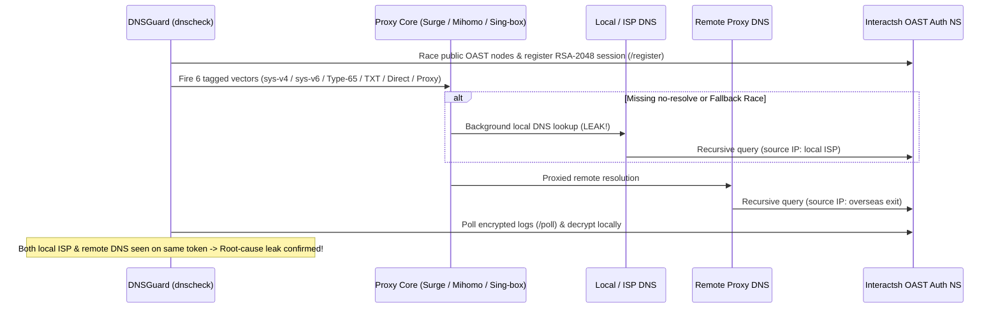

<div align="center">

# DNSGuard (`dnscheck`)

**Zero-dependency, pure-Python DNS leak auditor powered by Interactsh OAST — with CLI & local Web/Desktop UI.**

English | [简体中文](./README_CN.md)

[](https://github.com/yunfan777/dns-leak-guard/actions/workflows/ci.yml)
[](https://www.python.org/)
[-2ea44f)](./pyproject.toml)
[](./dnscheck/protocol/interactsh.py)
[](./LICENSE)

</div>

---

## Why DNSGuard?

Traditional browser-based DNS leak testers (e.g., `ipleak.net`, `dnsleaktest.com`) frequently produce **false negatives** in modern proxy setups (**Surge**, **Clash / Mihomo**, **Sing-box** with TUN + Fake-IP):

1. **Rule-set Whitelist Bias**: Popular proxy rule-sets hardcode well-known leak-test domains into `PROXY` rules, making tests look "100% safe" while unlisted domains silently leak to your ISP.
2. **Missed Pre-Resolution & Concurrent Race Leaks**: When IP rules (`RULE-SET,LAN`, `GEOIP,CN`, `IP-CIDR`) omit `,no-resolve`, or when `nameserver` + `fallback` race concurrently, the proxy core queries your local ISP DNS in plaintext *before* connecting via the remote proxy. Single-shot HTTP reflection pages only see the final egress and miss the leaked query completely.
3. **No Protocol / Channel Isolation**: Browsers cannot separately audit OS stub resolution (`getaddrinfo`), **DNS `Type 65 (HTTPS)` record leaks**, non-proxy-aware CLI traffic (`ProxyHandler({})`), or transparent UDP-53 hijacking.

**DNSGuard solves this with a built-in, zero-dependency ProjectDiscovery Interactsh (OAST) client**: it races public `oast.*` authoritative nameservers for the lowest RTT, fires 6 tagged 33-char unique subdomains concurrently, decrypts every raw DNS packet captured at the authoritative NS (`RSA-OAEP-SHA256` + `AES-256-CTR/CFB128`), and pinpoints the exact root cause of any leak.



---

## Key Features

1. **Interactsh OAST Out-of-Band Leak Attribution & UDP-53 Hijack Audit (`leak`)**
   - Zero-dependency `RSA-OAEP-SHA256` & `AES-256-CTR` / `AES-256-CFB128` OAST client with concurrent multi-server latency racing, optional `--oast-server` / `--oast-token` for self-hosted or PDCP servers, and automatic `bash.ws` fallback.
   - **6-Vector Attribution Matrix**: isolates `sys-v4`, `sys-v6`, `qtype65` (RFC 9460 `HTTPS` bypass), `udp-sys` (`TXT` race probe with Surge deadlock-free `TXT` nuance), `direct-sni` (bypassing system HTTP proxy), and `proxy-sni` (Fake-IP Host/SNI sniffing), with strict callback verification (never reports false-green on zero OAST callbacks).
   - **Fake-IP Canary UDP-53 Audit**: cross-verifies Akamai Dual-Stack (`whoami.ds.akahelp.net` `TXT`), Google `TXT`, CloudFront `A`, and `8.8.8.8:53` / `1.1.1.1:53` while using a Fake-IP canary to distinguish local proxy `dns-hijack` from true ISP port-53 hijacking.
2. **Read-Only Proxy Configuration & Rule Auditor (`audit`)**
   - Automatically detects running **Surge for Mac (`surge-cli`)**, runs a dry-run `rule explain` on an unlisted canary domain to catch synchronous local DNS lookups (e.g., `RULE-SET,LAN,DIRECT` or `GEOIP,CN` missing `,no-resolve`) and measures exact latency overhead — strictly read-only, never reading or exposing proxy credentials or subscription URLs.
3. **Local System DNS & Proxy Environment Diagnostics (`env`)**
   - Parses `/etc/resolv.conf`, macOS `scutil --dns` / `scutil --proxy`, scans `utun*` / `tun*` / `wg*` virtual interfaces, and detects **Fake-IP (`198.18.0.0/15`)** and **EDNS Client Subnet (ECS)** exposure.
4. **Split-Routing & Multi-Egress Matrix (`split`)**
   - Concurrently compares domestic direct egress, global egress, Cloudflare Anycast (`colo`), and IPv6 egress to detect split-routing mode and **IPv6 bypass leaks**.
5. **AI Services Connectivity & Region Lock Audit (`ai`)**
   - Tests OpenAI (`chatgpt.com`, `api.openai.com`), Claude, Gemini, Grok, Perplexity, GitHub Copilot, Cursor, OpenRouter, Groq, HuggingFace, plus domestic baselines (DeepSeek / Kimi) for DNS mode, per-domain exit region, geo-blocks, and Cloudflare challenges.
6. **WebRTC / STUN UDP & IPv6 Leak Detection (`webrtc`)**
   - Pure-Python **RFC 5389 STUN Binding Request** (`XOR-MAPPED-ADDRESS`) paired with browser-native `RTCPeerConnection` ICE candidate auditing in the Web UI.
7. **DNS Pollution Audit & Multi-Protocol Benchmark (`pollute` / `bench`)**
   - Compares plaintext UDP-53 responses against trusted DoH baselines to detect blackhole / forged IPs and ASN deviations; benchmarks UDP, DoT (853), and DoH (443) latency, availability, and DNSSEC (`AD`) support.
8. **Custom DNS Packet Inspector (`dig`)**
   - Native RFC 1035 / EDNS0 / ECS / RFC 9460 (`HTTPS` / `SVCB`) packet builder supporting `UDP / TCP / DoT / DoH / System`.

---

## Quick Start

Requires **Python 3.9+** only — **no third-party packages required**.

```bash
git clone https://github.com/yunfan777/dns-leak-guard.git
cd dns-leak-guard
```

### 1. CLI Usage

```bash
# Run the full security, OAST DNS leak & AI region audit
python3 dnscheck.py all

# Run Interactsh OAST multi-vector DNS leak detection
python3 dnscheck.py leak

# Optional: specify a custom / self-hosted Interactsh OAST server & token
python3 dnscheck.py leak --oast-server oast.pro
python3 dnscheck.py leak --oast-server your-oast.example.com --oast-token YOUR_TOKEN

# Run individual diagnostic modules
python3 dnscheck.py audit
python3 dnscheck.py env
python3 dnscheck.py split
python3 dnscheck.py ai
python3 dnscheck.py webrtc
python3 dnscheck.py pollute
python3 dnscheck.py bench

# Export machine-readable JSON (ideal for CI / automation)
python3 dnscheck.py leak --json
python3 dnscheck.py all --output report.json

# Custom DNS packet inspector (supports Type 65 HTTPS & ECS CIDR)
python3 dnscheck.py dig www.google.com --server 1.1.1.1 --proto doh --type HTTPS
python3 dnscheck.py dig www.taobao.com --server 223.5.5.5 --proto udp --ecs 114.114.114.0/24
```

### 2. Local Web / Desktop Dashboard

Binds strictly to `127.0.0.1` for local privacy and cross-verifies OS socket probes alongside live browser `fetch` and `RTCPeerConnection` WebRTC checks:

```bash
# Start local Web UI and open browser (default http://127.0.0.1:8765)
python3 dnscheck.py ui

# Launch as a standalone desktop window (Chrome / Edge / Brave --app)
python3 dnscheck.py ui --app
```

### 3. Optional Installation & Shortcuts

```bash
pip3 install --no-deps -e .
dnscheck leak

# Or run as a Python module
python3 -m dnscheck ui

# Or use Makefile targets
make leak
make ui
make test
```

---

## Common Leak Remediation Cheat Sheet

| Detected Issue | Recommended Fix |
| :--- | :--- |
| **Pre-resolution / Concurrent Race Leak under Fake-IP** | **Surge**: Append `,no-resolve` to `RULE-SET,LAN,DIRECT`, all IP-bearing `RULE-SET`s, and `GEOIP,CN`; place a domestic domain rule-set (e.g., `ChinaDomain.list` + `DOMAIN-SUFFIX,cn`) above `GEOIP,CN`.<br>**Mihomo / Clash**: Append `,no-resolve` to all `IP-CIDR` / `GEOIP` rules, clear `fallback: []`, and use `respect-rules: true` with `nameserver-policy`. |
| **DNS Type 65 (`HTTPS`) Bypassing Fake-IP** | **Mihomo (v1.19.19+)**: Append `#disable-qtype-65=true` to upstream DNS entries. |
| **Plaintext ISP DNS / IPv6 Bypass Leak** | Remove `system` from `dns-server`, switch to IP-based encrypted DoH (e.g., `https://223.5.5.5/dns-query`), and disable `ipv6` / `ipv6-vif` if IPv6 proxying is not configured. |
| **Proxy Safe but Direct CLI / OS Stub Leaking** | Enable **Surge Enhanced Mode (VIF)** or **TUN + Fake-IP** instead of relying solely on HTTP/SOCKS system proxy settings. |

---

## Project Structure

```text
.
├── dnscheck.py                  # Standalone CLI executable entry point
├── pyproject.toml               # Zero-dependency packaging metadata
├── Makefile                     # Convenience targets
├── dnscheck/
│   ├── __main__.py              # `python -m dnscheck` entry point
│   ├── protocol/
│   │   ├── dns_packet.py        # Native RFC 1035 / EDNS0 / ECS / Type-65 codec
│   │   ├── transports.py        # UDP / TCP / DoT (853) / DoH (443) / System transports
│   │   ├── interactsh.py        # Zero-dependency Interactsh OAST client (RSA-OAEP + AES-CTR/CFB)
│   │   └── stun.py              # Native RFC 5389 STUN UDP client
│   ├── detectors/
│   │   ├── dns_leak.py          # OAST 6-vector attribution + echo + UDP-53 hijack audit
│   │   ├── system_env.py        # OS DNS / proxy / TUN / Fake-IP / ECS diagnostics
│   │   ├── split_route.py       # 4-way split-routing egress comparison
│   │   ├── ai_services.py       # AI platform connectivity & region-lock checks
│   │   ├── webrtc_ipv6.py       # STUN UDP & IPv6 leak detection
│   │   └── pollution_bench.py   # DNS poisoning audit & encrypted DNS benchmarks
│   ├── enricher/ip_intel.py     # IP geolocation / ASN / Fake-IP enrichment
│   ├── cli/                     # CLI parser & CJK-aligned ANSI terminal renderer
│   └── web/                     # Local 127.0.0.1 REST API & single-page dashboard
└── tests/                       # Unit tests (including OpenSSL crypto interop & mock OAST)
```

---

## Testing

```bash
python3 -m unittest discover -s tests -v
```

## Contributing

Issues and pull requests are welcome. Please keep the core tool **zero-dependency** (Python 3.9+ standard library only) and include unit tests for any protocol or detector changes.

## License

Released under the [MIT License](./LICENSE).
