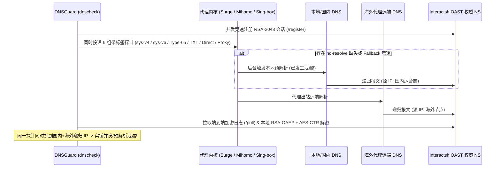

<div align="center">

# DNSGuard (`dnscheck`)

**零第三方依赖、纯 Python 原生协议栈驱动的 DNS 泄漏深度审计工具 —— 内置 Interactsh OAST 带外权威抓包引擎，支持 CLI 与本地 Web / 桌面可视化控制台。**

[English](./README.md) | 简体中文

[](https://github.com/yunfan777/dns-leak-guard/actions/workflows/ci.yml)
[](https://www.python.org/)
[-2ea44f)](./pyproject.toml)
[](./dnscheck/protocol/interactsh.py)
[](./LICENSE)

</div>

---

## 为什么常规网页测不出代理环境的隐蔽 DNS 泄漏？

在 **Surge / Clash (Mihomo) / Sing-box** 的 **TUN + Fake-IP** 环境下，常规浏览器检测站（如 `ipleak.net`、`dnsleaktest.com`）存在三大盲区：

1. **分流规则“应试白名单”**：主流规则集已将知名检测站硬编码进了 `PROXY` 域名列表，测试时永远全绿，但日常访问冷门海外域名依然泄漏。
2. **漏抓“预解析 / 并发抢答”泄漏**：当 `RULE-SET,LAN`、`GEOIP,CN`、`IP-CIDR` 漏写 `,no-resolve`，或配置了国内 `nameserver` + 海外 `fallback` 竞速时，代理内核会在后台**先向国内运营商明文查一次域名**，再走海外节点连接。单次 HTTP 反射页面只看到最终出口，完全无法察觉后台已经泄露。
3. **浏览器无法隔离底层协议通道**：无法分别测试 OS Stub (`getaddrinfo`)、**DNS `Type 65 (HTTPS)` 记录穿透**、绕过系统 HTTP 代理的命令行进程以及明文 UDP-53 透明劫持。

**DNSGuard 通过零依赖实现的 ProjectDiscovery Interactsh (OAST) 加密客户端解决上述盲区**：并发竞速连接最低延迟的公网 `oast.*` 权威名称服务器，投递 6 组带通道标签的 33 位随机子域名，**逐包捕获到达权威 NS 的每一个递归 DNS 查询**（含源 IP、QType 与 EDNS ECS 子网），精准还原泄漏根因。



---

## 核心功能特性

1. **Interactsh OAST 带外权威抓包 & 透明劫持审计 (`leak`)**
   - 纯标准库实现 `RSA-OAEP-SHA256`、`AES-256-CTR` / `AES-256-CFB128` 解密与多节点并发竞速握手，支持 `--oast-server` / `--oast-token` 对接自建或 PDCP 节点，受限时自动降级至 `bash.ws` 会话备援。
   - **6 维通道带外归因矩阵**：精准区分 `sys-v4`、`sys-v6`、`Type 65 (HTTPS)` 穿透、`TXT` 真实上游竞速、绕过系统代理直连 (`direct-sni`) 与代理嗅探出站 (`proxy-sni`)。
   - 联动 Akamai 双栈 `whoami.ds.akahelp.net` (`TXT` 含 ECS)、Google TXT、CloudFront A 及直连 `8.8.8.8:53` / `1.1.1.1:53` 探针，输出 **0–100 安全评分**。
2. **本机系统 DNS 环境诊断 (`env`)**
   - 自动解析 `/etc/resolv.conf`、macOS `scutil --dns` / `scutil --proxy`、扫描 `utun*` / `tun*` / `wg*` 虚拟网卡，自动识别代理内核、**Fake-IP (`198.18.0.0/15`)** 与 **ECS** 状态。
3. **国内外网络分流与多出口 IP 对比 (`split`)**
   - 并发对比国内直连、海外通用、Cloudflare Anycast (`colo`) 与 IPv6 双栈出口，识别分流模式与 **IPv6 旁路泄漏**。
4. **一线 AI 服务连通性、分流与锁区检测 (`ai`)**
   - 并发检测 OpenAI (`chatgpt.com`, `api.openai.com`)、Claude、Gemini、Grok、Perplexity、Copilot、Cursor、OpenRouter、Groq、HuggingFace 与国内基准 DeepSeek / Kimi，判断 DNS 模式、出口地区、锁区限制与 Cloudflare 风控盾。
5. **WebRTC / STUN UDP 穿透与 IPv6 泄漏检测 (`webrtc`)**
   - 原生实现 **RFC 5389 STUN Binding Request**（`XOR-MAPPED-ADDRESS` 解码），Web 控制台同步执行浏览器 `RTCPeerConnection` ICE 候选交叉对比。
6. **DNS 污染/投毒检测 & UDP / DoT / DoH 多协议测速 (`pollute` / `bench`)**
   - 以可信 DoH 解析为基准比对明文 UDP-53，揪出黑洞 IP、跨品牌抢答投毒与 ASN 偏离；并发评测国内外主流解析器的 UDP / DoT (853) / DoH (443) 延迟与 DNSSEC (`AD`) 支持度。
7. **自定义 DNS 报文探测器 (`dig`)**
   - 原生构造与解析 RFC 1035 / EDNS0 / ECS / RFC 9460 (`HTTPS` / `SVCB`) 报文，支持 `UDP / TCP / DoT / DoH / System` 任意切换。

---

## 快速上手

仅需 **Python 3.9+**，克隆后**无需 `pip install` 任何第三方依赖**即可直接运行：

```bash
git clone https://github.com/yunfan777/dns-leak-guard.git
cd dns-leak-guard
```

### 1. CLI 命令行模式

```bash
# 运行完整深度安全、OAST 泄漏与 AI 解锁审计
python3 dnscheck.py all

# 仅运行 Interactsh OAST 多通道 DNS 泄漏深度检测
python3 dnscheck.py leak

# 可选：指定自定义 / 自建 Interactsh OAST 服务器与认证 Token
python3 dnscheck.py leak --oast-server oast.pro
python3 dnscheck.py leak --oast-server your-oast.example.com --oast-token YOUR_TOKEN

# 运行其余单项模块
python3 dnscheck.py env
python3 dnscheck.py split
python3 dnscheck.py ai
python3 dnscheck.py webrtc
python3 dnscheck.py pollute
python3 dnscheck.py bench

# 导出机器可读 JSON 报告（适合 CI / 自动化脚本）
python3 dnscheck.py leak --json
python3 dnscheck.py all --output report.json

# 自定义 DNS 报文探测（支持 Type 65 HTTPS 记录与 ECS 前缀）
python3 dnscheck.py dig www.google.com --server 1.1.1.1 --proto doh --type HTTPS
python3 dnscheck.py dig www.taobao.com --server 223.5.5.5 --proto udp --ecs 114.114.114.0/24
```

### 2. 本地 Web / 桌面可视化控制台模式

服务严格绑定在 `127.0.0.1`，不对外暴露，支持系统底层 Socket 探针与浏览器原生 `fetch` / `RTCPeerConnection` 同屏交叉审计：

```bash
# 启动 Web 控制台并自动打开浏览器（默认 http://127.0.0.1:8765）
python3 dnscheck.py ui

# 以独立桌面应用窗口模式启动（支持 Chrome / Edge / Brave --app）
python3 dnscheck.py ui --app
```

### 3. 可选：全局安装或使用 `make`

```bash
pip3 install --no-deps -e .
dnscheck leak

# 或直接以模块方式运行
python3 -m dnscheck ui

# 或使用 Makefile 快捷指令
make leak
make ui
make test
```

---

## 常见泄漏修复速查（实测总结）

| 检出问题 | 常见代理客户端根治要点 |
| :--- | :--- |
| **Fake-IP 下仍向国内 DNS 预解析 / 并发泄漏** | **Surge**：为 `RULE-SET,LAN,DIRECT`、所有含 IP 的 `RULE-SET` 及 `GEOIP,CN` 补齐 `,no-resolve`，并在其上方前置国内域名集（如 `ChinaDomain.list` + `DOMAIN-SUFFIX,cn`）。<br>**Mihomo / Clash**：所有 `IP-CIDR` / `GEOIP` 追加 `,no-resolve`，清空 `fallback: []`，改用 `respect-rules: true` + `nameserver-policy`。 |
| **Type 65 (`HTTPS`) 记录穿透 Fake-IP** | **Mihomo (v1.19.19+)**：在 DNS 上游后追加 `#disable-qtype-65=true`。 |
| **运营商明文 DNS / IPv6 旁路泄漏** | 在 `[General]` / `dns:` 中移除 `system` 运营商默认 DNS，改用纯 IP 加密 DoH（如 `https://223.5.5.5/dns-query`），不需要公网 IPv6 时关闭 `ipv6` / `ipv6-vif`。 |
| **代理通道安全但本机直连进程泄漏** | 仅开启了系统 HTTP/SOCKS 代理，建议开启代理软件的 **增强模式 (Surge VIF) / TUN 虚拟网卡 + Fake-IP** 全局接管。 |

---

## 项目结构

```text
.
├── dnscheck.py                  # 可执行入口脚本
├── pyproject.toml               # 零依赖打包配置 (dnscheck CLI)
├── Makefile                     # 快捷命令封装
├── dnscheck/
│   ├── __main__.py              # `python -m dnscheck` 模块入口
│   ├── protocol/
│   │   ├── dns_packet.py        # 原生 RFC 1035 / EDNS0 / ECS / Type-65 报文编解码
│   │   ├── transports.py        # UDP / TCP / DoT (853) / DoH (443) / System 传输层
│   │   ├── interactsh.py        # 零依赖 Interactsh OAST 客户端 (RSA-OAEP + AES-CTR/CFB)
│   │   └── stun.py              # 原生 RFC 5389 STUN UDP 协议栈
│   ├── detectors/
│   │   ├── dns_leak.py          # OAST 6 维通道归因 + 权威回显 + UDP-53 透明劫持审计
│   │   ├── system_env.py        # 系统 DNS / 代理 / TUN / Fake-IP / ECS 环境诊断
│   │   ├── split_route.py       # 国内外四维分流出口矩阵
│   │   ├── ai_services.py       # 一线 AI 平台连通性与锁区检测
│   │   ├── webrtc_ipv6.py       # STUN UDP 与 IPv6 双栈泄漏检测
│   │   └── pollution_bench.py   # DNS 投毒比对与多协议测速
│   ├── enricher/ip_intel.py     # IP 归属地 / ASN / Fake-IP 识别与批量增强
│   ├── cli/                     # 命令行路由与 CJK 对齐 ANSI 渲染器
│   └── web/                     # 127.0.0.1 本地 REST API 与单页可视化控制台
└── tests/                       # 单元测试（含 OpenSSL 加解密互操作与 Mock OAST 测试）
```

---

## 运行单元测试

```bash
python3 -m unittest discover -s tests -v
```

## 开源协议

本项目基于 [MIT License](./LICENSE) 开源。
